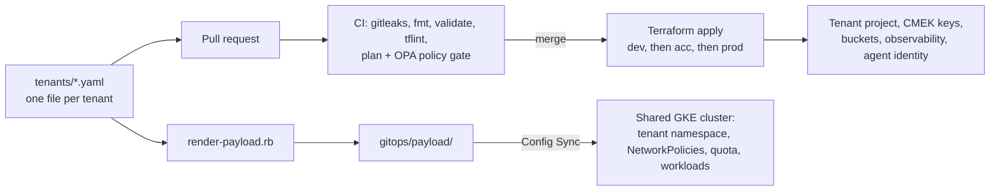

# multi-tenant-config

The tenant registry, deployment roots, policies, and CI/CD for a multi-tenant GCP platform that hosts data workloads and durable AI agents. Adding a tenant is **one YAML file and one pull request**: the pipeline plans it, gates it with policy, and applies it through `dev` → `acc` → `prod`, while a GitOps loop (Config Sync) delivers its namespace, isolation policies, and workloads to the shared cluster.

This is **repo 2 of 2**. It consumes versioned Terraform modules from [`multi-tenant-platform`](https://github.com/aidaploco/multi-tenant-platform) by **pinned git tag**, never `main`. The example workload that runs on the platform is [`agent-chassis`](https://github.com/aidaploco/agent-chassis).

> **This is a reference implementation.** It was built without a live GCP organization (deliberately, to avoid cost): the cloud paths are exercised with mocked providers and policy tests, and the runtime plane is proven end to end on a local `kind` cluster. [`docs/VERIFICATION.md`](docs/VERIFICATION.md) is the honest ledger of what was run live versus assumed. The tenants (`abf`, `helix`), the `company.com` addresses, and every org, billing, and customer ID in the examples are fictional placeholders.

## How it works



- **The registry is the interface.** [`tenants/`](tenants/) holds one YAML per tenant; the Terraform root loops over every file with `for_each`. No per-tenant directories, no copy-paste, no code generation ([ADR-0001](docs/adr/0001-platform-architecture.md), [ADR-0002](docs/adr/0002-two-axis-tenancy-and-schema-v2.md)).
- **Two axes.** Axis 1 is a tenant's *infrastructure* (project, keys, storage); axis 2 is its *workloads* (`units`), rendered into Kubernetes manifests and delivered by GitOps.
- **Policy before apply.** Every plan goes through an OPA gate whose policies live in `multi-tenant-platform` and are pinned here. CMEK is mandatory, alert policies must route somewhere, and large destroys are thresholded.
- **Tenant isolation on a shared cluster.** Namespace per tenant, default-deny ingress and egress with a platform-owned allow-list, tenant RBAC narrowed to view + operate, Gatekeeper constraints, and a per-tenant trace plane ([ADR-0013](docs/adr/0013-per-tenant-namespaces.md), [ADR-0022](docs/adr/0022-tenant-custom-vs-curated-app-config-delivery.md), [ADR-0023](docs/adr/0023-platform-owned-networkpolicies-and-tenant-rbac-narrowing.md), [ADR-0027](docs/adr/0027-per-tenant-phoenix-trace-plane.md)).
- **Durable agents.** Temporal owns agentic orchestration; Airflow/Composer is parked until a batch tenant needs it ([ADR-0016](docs/adr/0016-orchestration-strategy-temporal.md)).

## What lives here

| Path | Purpose |
| ---- | ------- |
| [`tenants/`](tenants/) | **One YAML per tenant** — the entire onboarding interface ([schema](tenants/README.md)). |
| `terraform/tenants/` | The `for_each` root that reads every tenant file. |
| `terraform/runtime/`, `terraform/tenant-runtime/` | The shared runtime plane (network, GKE, Config Sync) and per-tenant namespaces. |
| `bootstrap/` | One-off org bootstrap: state bucket, CI identities (Workload Identity Federation). |
| `gitops/` | What Config Sync reconciles: cluster policy, and rendered per-tenant payload. |
| `config/` | App-side role manifests and packs, rendered into ConfigMaps. |
| `scripts/` | Registry checks, the payload renderer, the eval gate, the local `kind` plane, demos. |
| `.github/workflows/` | Plan on PR, gated apply on merge, drift detection, offboarding ([workflow guide](.github/workflows/README.md)). |
| [`docs/`](docs/) | 28 ADRs, runbooks, the roadmap ([`PLAN.md`](docs/PLAN.md)), and [`VERIFICATION.md`](docs/VERIFICATION.md). |
| [`VERSIONS.md`](VERSIONS.md) | Single source of truth for pinned module versions; CI checks the Terraform refs against it. |

## Onboard or change a tenant

1. Add or edit `tenants/<slug>.yaml` ([schema](tenants/README.md)).
2. Open a PR. CI runs `plan` and the policy gate and comments the diff.
3. Merge. Auto-apply to **dev**, then manual approval for **acc**, then **prod**.
   > The approval gates are GitHub **environment protection rules** on `acc`/`prod`. They exist only once configured in repo settings, and the credentialed pipeline stays dormant until `WIF_PROVIDER` is set, so no gate is enforced before then.

Offboarding is its own workflow with a pre-flight check ([runbook](docs/runbooks/tenant-offboard.md)).

## Try it locally

No cloud account needed. The checks below use only Ruby, Terraform, and bash:

```bash
ruby scripts/test-render-payload.rb     # renderer golden tests
ruby scripts/test-check-eval-gate.rb    # eval-gated promotion tests
ruby scripts/render-payload.rb --check  # committed gitops/ matches the registry
bash scripts/check-versions.sh          # module refs match VERSIONS.md
terraform fmt -check -recursive
```

To run the whole platform on a laptop (kind cluster, local registry, Gatekeeper, Config Sync, Temporal, and a real agent workload), follow the [local kind runbook](docs/runbooks/local-kind-plane.md). `scripts/demo/pod-kill-and-resume.sh` kills an agent pod mid-conversation and shows the workflow resuming.

## Known limitations

- **No live GCP organization.** Cloud resources are validated with mocked `terraform test` suites and OPA tests; the runtime plane is proven on `kind`. See [`docs/VERIFICATION.md`](docs/VERIFICATION.md).
- **Not built yet:** `vpc-sc`, Cloud SQL, and the BigQuery/Pub/Sub dependencies of the data-unit archetype. They are deferred to activation and listed in [`docs/PLAN.md`](docs/PLAN.md).
- **Composer is parked** behind a flag ([ADR-0016](docs/adr/0016-orchestration-strategy-temporal.md)).
- **The trace plane has no auth yet** (tracked in [ADR-0027](docs/adr/0027-per-tenant-phoenix-trace-plane.md)), and the Temporal server is a dev server.
- **Module versioning is manual:** tags are cut by hand and recorded in `VERSIONS.md`.

## License

No license is granted. The source is published so it can be read and reviewed; please do not copy, redistribute, or reuse it without permission. All rights reserved.
